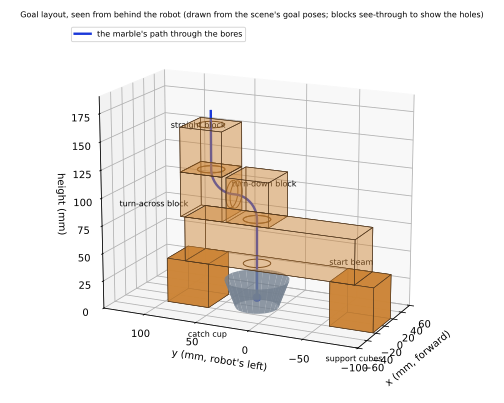

# Build a wooden block marble run: set three drilled blocks so their holes meet, then roll the marble down into the cup

Build the marble run on the start beam: set the turn-down block on the beam over the beam's hole with its side hole facing left, set the turn-across block on the beam just left of it with its side hole against the first block's side hole, and set the straight block on top of the turn-across block. Then drop the blue marble into the straight block's top hole so it rolls down into the cup.



## Scoring

Judged at the end of the run from a photo, a ruler and the trial video. Three joints, each between two holes that meet: (1) beam to turn-down block: the turn-down block sits on the beam with its bottom hole over the beam's hole, the two hole centres within 6 mm of each other across the joint; (2) turn-down to turn-across block: their side holes face each other (within 20 degrees), the two hole centres within 6 mm of each other across the joint and the two faces at most 6 mm apart; (3) turn-across to straight block: the straight block sits on the turn-across block's top hole, centres within 6 mm across. A joint counts only with both blocks sitting flat (tilted at most 5 degrees, the upper block's face within 3 mm of the face below), still, and let go (no gripper within 3 cm), and with the start beam still lying on its two cubes. The marble run counts when, on the video, the marble went into the straight block's top hole after the gripper let go, stayed inside the blocks' holes and the drop below the beam, and lies in the cup (inside it, below the rim), moving under 2 cm/s, for 1 s. 1.0: all three joints and the marble run. 0.75: all three joints, marble not run into the cup. 0.5: two joints. 0.25: one joint. 0: no joint; doing nothing scores 0. A marble carried or dropped straight into the cup, or one that left the blocks on the way, earns nothing.

How `score()` reads each condition (block frames: origin at the block's centre; hole centres are the middles of the
holed faces):

- **Joint 1:** the turn-down block's bottom hole centre is within `JOINT_TOL` = 6 mm horizontally of the beam's top
  hole centre and within `SEAT_TOL` = 3 mm in height; the beam's hole faces up and the block's faces down (within
  `FACE_DEG` = 20 degrees). **Joint 2:** the side holes face each other (normals opposed within 20 degrees); along
  the turn-down block's side-hole axis the faces are -3 to `GAP_MAX` = 6 mm apart, and across it the centres are
  within 6 mm. **Joint 3:** the straight block's lower hole (either way up) on the turn-across block's top hole,
  as joint 1.
- **Flat, still, let go:** each block tilted at most `TILT_MAX` = 5 degrees (either way up), moving under 1 cm/s,
  and every gripper's centre point at least 30 mm outside its bounding box. The start beam must still lie on its
  cubes (centre 60 +- 4 mm above the table, flat), or no joint counts.
- **Marble run** (tracked every control step): it starts when the marble's centre is 8 mm or more inside the
  straight block's top hole (a pinched marble cannot get there: the fingers do not fit in a 24 mm hole), and
  stays valid while the marble's centre is inside a bore (within 7 mm of its centre line, or up to 8 mm past a
  hole, across a joint), in the drop from the beam's bottom hole to the cup, or in the cup. It ends **arrived**
  when the marble is in the cup (centre below the rim, 4 mm inside the wall); if it is seen anywhere else it
  **left** the run until it goes in at the top again. Full credit needs arrived and let go, with the marble moving
  under 2 cm/s for 1 s (spin under 3 rad/s: with no rolling resistance in the model a marble on the cup's flat
  base keeps rolling round it at up to about 8 mm/s, where a real one stops).

`success()` is a score of 1.0. Why the shortcuts fail: a marble carried to the cup or dropped into it past the
beam's side never started a run at the top hole, so it earns nothing for the marble; one that pops out at a joint
has left the run. `test_build_block_marble_run_and_roll_marble_to_cup.py` checks these layouts with the run record set; stepped marble paths (carried in,
dropped in) score 0.75 with the blocks built and 0 without. Our wrong-way run (this module with `DEMO_WRONG` on) turns the turn-down block the other way round: the wrist turned it only 63 of 90 degrees, so it sat over the beam's hole 27 degrees askew; the turn-across block, set where the photo shows it, came down on its corner, tipped off the beam onto the table and pushed the turn-down block 9 mm off the beam's hole; the straight block went down on the table and the marble was knocked off the table. No joint stands: 0.0.

## Run and score

From this task folder, with the official YAM Arena environment installed:

```sh
inspect-robots run --embodiment yam_arena --policy yam_scripted \
  -E task=build_block_marble_run_and_roll_marble_to_cup.py -E object_jitter=0 -E control_hz=20 \
  --instruction "Build the marble run on the start beam: set the turn-down block on the beam over the beam's hole with its side hole facing left, set the turn-across block on the beam just left of it with its side hole against the first block's side hole, and set the straight block on top of the turn-across block. Then drop the blue marble into the straight block's top hole so it rolls down into the cup." \
  --scorer task_score --max-steps 2400 --epochs 1 --store-frames --log-dir ./demo-run
```

For a model trial use `--policy dream`. Each trial allows 2,400 steps (120 s at 20 Hz); the scripted plan takes
63.1 s. `pytest` checks the scorer on named layouts. Seeds: none (`object_jitter=0`).

## The scene

Products, sizes and positions are in task.json's `setup` (mm, from the midpoint between the arm bases; x forward,
y to the robot's left; heights above the table top).

- **Drilled blocks** (one free body each, built by `channel_blocks.py`): beech, 700 kg/m3 (estimate), friction
  0.4/0.3, contact offset 0.5 mm. Every bore is 24 mm across, drawn as a 12-sided polygon whose flats are 12 mm
  from the bore's axis; the block is cut into convex pieces, one per bore facet, so the bore stays open. Straight
  block: 40 mm cube, 12 pieces, 31.8 g. Turn blocks: 40 mm cube, 48 pieces, 34.5 g; the bore's centre line is a
  quarter circle of radius 20 mm about the edge between the two holed faces, in four straight 22.5-degree
  segments (the bend's shape is an estimate). Beam: 160 x 40 x 40, 12 pieces, 166 g, hole 20 mm from its middle.
- **Support cubes:** plain 40 mm cubes, 44.8 g. **Catch cup:** Winco SCP-15, 24 wall facets 0.5 mm thick, 1 mm
  base (thicknesses and 22 g are estimates), friction 0.4/0.3.
- **Marble:** a 15 mm sphere, 4.4 g (glass 2.5 g/cm3, estimate), friction 0.4/0.3, contact offset 0.5 mm.

## Demonstration

The scripted demonstration uses the left arm; the right arm parks. For each block it reads the block's pose, picks
it top-down across two solid faces (pads 37 mm apart on the 40 mm block), lifts it to 165 mm, turns it a quarter
turn on the way when needed (the two turn blocks), holds it 40-45 mm over its place (worked out from where the
block below it actually lies), takes the block's own offset there off the hand target, lowers it to 2 mm above its
place and lets go. It then picks the marble (pads 12 mm apart on the 15 mm marble), holds it 40 mm over the
straight block's top hole, corrects the offset, lowers it to 1.5 mm above the top face and lets go; the arm parks.
Our GPU run of this demonstration (no jitter) reached full score at 55.3 s: the turn-down block came to rest 0.5 mm off the beam's hole, the side joint with a 4.9 mm gap and 0.9 mm sideways, the straight block 3 mm off the turn-across block's hole, and the marble, let go at the top hole, was in the cup 0.2 s later (the cup is under the beam, so the cameras lose the marble at the top hole; the run's `success` is the cup reading). With every loose object shifted up to 10 mm at random it also reached full score in 2 of 2 trials. It reads the simulator's poses to plan its moves; nothing is moved for it.

## Sources and estimates

- HABA Ball Track Large Basic Pack (Kugelbahn-Bausatz), HABA 1136 (1001136001): maker page
  https://www.haba-play.com/en-at/p/ball-track-large-basic-pack--1001136001 (15 mm glass marbles, EUR 139.99);
  retailer https://www.prospiel.ch/de/spielen-im-zyklus-1/holzspielzeug/kugelbahn-aus-holz/kugelbahn-bausatz-42-tlg-6-murmeln-101.202.100
  (42 solid beech pieces incl. 4 redirection blocks and 2 tunnel blocks, 6 marbles, base block 4 x 4 x 4 cm,
  EAN 4010168011363, CHF 135); parts photo https://www.eurobus.jp/?pid=161197191 (drilled cubes and the drilled
  160 mm block).
- Winco SCP-15 1.5 oz stainless sauce cup: https://www.wincous.com/products/scp-15 (1.5 oz);
  https://www.zesco.com/products/winco-scp-15-1-5-oz-sauce-cup-stainless-steel (57.15 top, 38.1 bottom,
  25.4 high).
- Pieces: the turn blocks are two of the set's four redirection blocks; the straight block is taken to be one of
  its two tunnel blocks and the beam its 160 mm drilled block (both as photographed by the retailer); check on
  the set. Any 40 mm beech cube with a straight 24 mm bore can stand in for the straight block.
- Estimates (one minute with a ruler and a kitchen scale): hole 24 mm, the turn blocks' bend (look into the
  hole), the beam's hole 100 mm from one end, masses (beech 0.7 g/cm3, glass 2.5 g/cm3), the cup's wall and mass,
  all frictions.

## Files

- `task.json`, `README.md`, `goal.svg` (the goal layout, drawn from the scene)
- `build_block_marble_run_and_roll_marble_to_cup.py`: scene, scorer and scripted demonstration
- `channel_blocks.py`: the drilled blocks and the cup as convex pieces (part of this task)
- `yam_parts.py`, `yam_joints.py`, `yam_mesh.py`: the YAM Arena parts kit modules, copied unchanged
- `test_build_block_marble_run_and_roll_marble_to_cup.py`: CPU checks of the scorer on the start, the goal and partial and shortcut layouts
